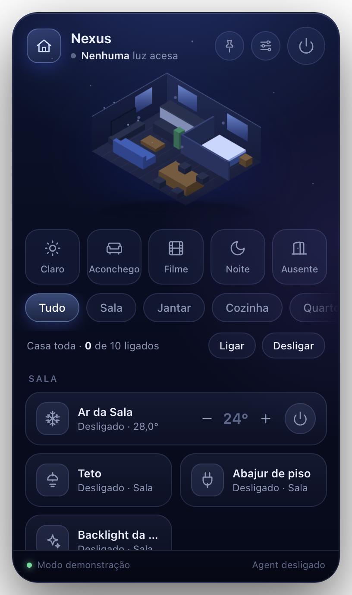

# @nexus/desktop — Nexus Desktop (Windows + macOS)

App de bandeja (Electron + TypeScript) com duas funções:

1. **Agent** — conecta este computador ao Core (mesmo código de `apps/agent-windows`, agora também para macOS): heartbeat, métricas e ações `shutdown`/`restart`/`lock`/`executeCommand`. É a forma principal de instalar o Agent (substitui `install.ps1`).
2. **Widget** — popover na bandeja/menu bar para controlar o ambiente: cena isométrica, scenes (Claro, Aconchego, Filme, Noite, Ausente), abas por ambiente (Spaces), ligar/desligar tudo, cards por dispositivo e AC com −/+. Pode ser **fixado na área de trabalho** (arrastável, posição salva).



## Instalação (usuário final)

Baixe em `release/` (ou na aba Releases / página de downloads do Dashboard):

| SO | Arquivo |
|---|---|
| Windows 10/11 x64 | `Nexus-Setup-<versão>.exe` (instalador assistido, atalhos, desinstalador) |
| macOS Apple Silicon | `Nexus-<versão>-arm64.dmg` |
| macOS Intel | `Nexus-<versão>-x64.dmg` |

Os instaladores **não são assinados**: no Windows o SmartScreen mostra "Mais informações → Executar assim mesmo"; no macOS, arraste para Aplicativos e, na primeira vez, clique com o botão direito → Abrir (ou `xattr -dr com.apple.quarantine /Applications/Nexus.app`). Para assinar depois: Windows — defina `CSC_LINK`/`CSC_KEY_PASSWORD` e remova `signAndEditExecutable: false`; macOS — Developer ID (`CSC_LINK`, `APPLE_ID`, `APPLE_APP_SPECIFIC_PASSWORD`, `APPLE_TEAM_ID`), remova `identity: null` e adicione notarização.

## Primeira execução / pareamento

1. Abre a janela **Configurações**: informe a **URL do Core** (`https://core.seudominio.com` ou `http://192.168.1.10:4700`) e uma **API key** (`nxk_…`, Dashboard → API Keys; precisa ler e executar ações em dispositivos). A chave é guardada criptografada (Keychain/DPAPI via `safeStorage`).
2. Mantenha **Permitir controle remoto deste computador** ligado: o Agent se registra e fica **Aguardando aprovação** — aprove em Dashboard → Agents. A partir daí o PC aparece no widget e no Dashboard.
3. **Iniciar com o sistema** abre o app na bandeja ao ligar o computador.

Se a URL do Core ficar vazia o Agent tenta descoberta por broadcast UDP na rede local. A URL `http(s)` é convertida em `ws(s)` para o Agent.

Tray: clique abre/fecha o widget; botão direito → Fixar na área de trabalho, Configurações, Sair.

## Desenvolvimento

```bash
bun run --filter @nexus/desktop dev                 # build + electron .
NEXUS_DESKTOP_DEMO=1 bun run --filter @nexus/desktop dev   # widget com dispositivos fictícios, sem Core
NEXUS_DESKTOP_DEMO=1 NEXUS_DESKTOP_SCREENSHOT=$PWD/docs/widget.png electron .   # grava screenshots e sai
bun run --filter @nexus/desktop typecheck
```

No macOS as ações reais do Agent (desligar/reiniciar/bloquear) rodam de verdade; use `NEXUS_AGENT_SIMULATE=1` para simular em dev. No modo demo o Agent fica desligado.

## Build dos instaladores

```bash
bun run --filter @nexus/desktop dist:mac   # release/Nexus-<v>-arm64.dmg e -x64.dmg
bun run --filter @nexus/desktop dist:win   # release/Nexus-Setup-<v>.exe  (funciona a partir do macOS: NSIS sem wine, sem editar recursos do .exe)
bun run --filter @nexus/desktop dist       # os dois
```

`.github/workflows/desktop-release.yml` compila em `windows-latest`/`macos-latest` e publica os artefatos (tag `desktop-v*` cria a Release). Ícones: `bunx electron scripts/make-icons.cjs` regenera `build/` e `assets/`.

## Estrutura

```
src/main/      processo principal: main, tray, widget-window, settings-window,
               agent-service (Agent embutido), core-client (HTTP + polling 3s + demo), store (config + safeStorage)
src/preload/   ponte tipada (contextBridge → window.nexus)
src/renderer/  widget/ (UI, room.ts = cena SVG) · settings/ · shared/ (tokens CSS, ícones)
src/shared/    tipos IPC e regras puras (categorias de dispositivo, scenes)
scripts/       build.ts (esbuild → dist/) · make-icons.cjs
electron-builder.yml
```

O app é empacotado inteiro pelo esbuild (inclusive `ws` e o código do Agent), então o instalador não carrega `node_modules`.

## Notas

- O protocolo do Agent ainda declara `kind: "windows"` (`@nexus/agent-protocol`); no macOS o registro usa o mesmo valor, e o SO real vai em `system.operatingSystem`. Um `kind: "macos"`/plugin próprio depende de mudar o protocolo e o `@nexus/plugin-windows`.
- Scenes são presets locais (sobre `turn_on`/`turn_off` e `lock`); não há entidade "Scene" no Core ainda.
- No Windows o `.exe` gerado a partir do macOS não tem o ícone embutido no executável (precisa de wine/`rcedit`); o build no GitHub Actions (Windows) embute normalmente se `signAndEditExecutable` for removido.
